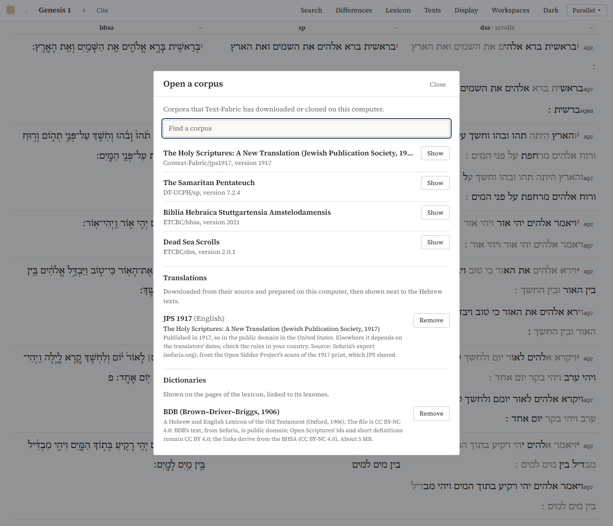

# Adding texts

The library holds everything the Explorer can show: the corpora on your computer, those it can download, the translations and the dictionaries. Open it with *Texts → Add a text…* in Parallel, or *Open a corpus* in Panes.

## Corpora on your computer

At the top, *Open a corpus* lists the corpora that are on your computer, in the folder where Text-Fabric keeps them (`text-fabric-data` in your home folder). *Open* opens one; *Show* shows one that is open already. *Find a corpus* narrows the list.

The first time a corpus is opened, the program prepares it, which takes from half a minute to a few minutes; after that it opens in a few seconds. In this version, only the BHSA, the Samaritan Pentateuch and the Dead Sea Scrolls are offered.

## Corpora that can be downloaded

*Can be downloaded* lists the corpora the program can get for you: the BHSA, the Samaritan Pentateuch and the Dead Sea Scrolls, from their own releases on GitHub. *Download* gets one, unpacks it and prepares it, with its progress shown. *Terms of use* links to the corpus' own page. If a download fails, *Try again* tries again; downloads already made are kept, so nothing is downloaded twice.

At the [first start](getting-started.md#the-first-start) the program offers all three at once.

## Translations

*Translations* lists the translations the program can add, each downloaded from its source and prepared on your computer. So far there is one: the [JPS 1917](datasets.md#the-jps-1917-translation), from Sefaria (about 5 MB). *Add* downloads and prepares it, in a few seconds; it then appears as a text next to the Hebrew.

*Remove* (and *Remove* again to confirm) deletes it. If it is open, it is removed the next time the program starts, and until then *Keep it* undoes the removal.

What a translation does in the interfaces:

- in Parallel and the Reader it is a column like the others, with the print's verse number where the 1917 print numbers otherwise;
- in the Interlinear, *Under* offers it as a line per verse;
- in the Concordance it can be searched in English (`word lower=lord`);
- it has no hover card, and it is left out of *Differences*.

## Dictionaries

*Dictionaries* lists the dictionaries the program can add. So far there is one: [BDB](datasets.md#the-bdb-dictionary) (about 5 MB). *Add* downloads it; *Remove* deletes it. Once it is added, its entries appear in the [lexicon](words.md#bdb), on the hover card, in the word panel and in the Interlinear.
