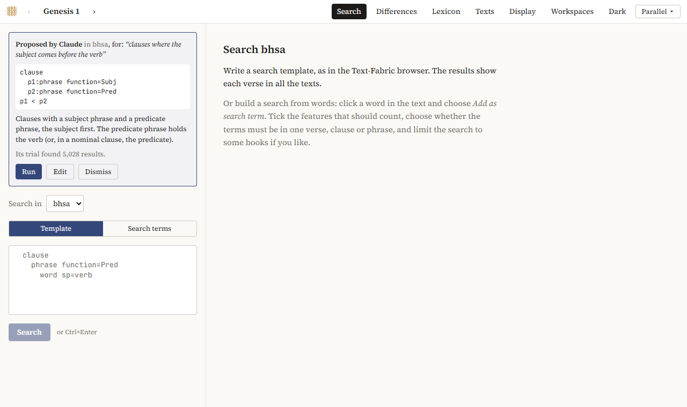

# Asking Claude or ChatGPT

You can ask Claude or ChatGPT, in your own words, for a search: *find all cases of >LHJM/ in the BHSA*, or *clauses where the object comes before the verb*. The assistant writes a search template, tries it, and sends it to the Explorer. You decide whether it runs.

This uses your own subscription: for Claude in Claude Desktop or Claude Code, for ChatGPT in the ChatGPT desktop app or Codex. Both work the same way; only setting them up differs (see [Setting it up](#setting-it-up)).

## What the assistant does, and what it doesn't

- The assistant writes the [search template](searching.md#templates); the Explorer shows it with the assistant's explanation, so you can read and change it.
- Before sending it, the assistant may check the template and try it on a few results, to see that it finds what you asked for.
- Nothing runs by itself: you click *Run*.
- The results always come from the Explorer's own search, never from the assistant's text, so they are the same as for a search you had typed yourself.
- The search keeps where it came from (*Proposed by Claude, … for: …*, or by ChatGPT or Codex): in its link, in a saved workspace, and when you cite it.

An assistant can be wrong. Check the template, and look at a few results before you trust a count.

## Setting it up

**Always first:** start CACCHT Explorer and keep it running. The assistant talks to the running program.

The Explorer's address for assistants is `http://127.0.0.1:8107/mcp`. 8107 is the program's usual port. If another program had taken it, the log (`.cfabric/logs/cfabric-browser.log` in your home folder) gives the address with the port the Explorer uses; installed with pip, the terminal shows it.

### In Claude Desktop

1. Download `CACCHT-Explorer.mcpb` from the release (under *Assets*, next to the program; see [Getting started](getting-started.md#download)).
2. Install it, in one of these ways:
   - double-click the downloaded file: Claude Desktop opens it and offers to install it; click *Install*;
   - or, in Claude Desktop, go to *Settings → Extensions*, and choose *Install Extension…* (under *Advanced settings*), then the file;
   - or drag the file into the *Settings → Extensions* window.
3. Check that *CACCHT Explorer* is switched on under *Settings → Extensions*.
4. Start a new chat. The tools menu (the button below the message box) now lists *CACCHT Explorer*.

You need a recent Claude Desktop. The extension needs nothing else: no Python and no Node.js of your own. If your Claude Desktop names its menus differently, look under *Extensions* for the button that installs one.

**Without the extension** (if installing it doesn't work): in Claude Desktop, *Settings → Developer → Edit Config* opens `claude_desktop_config.json`. Add the program, with its path on your computer, and restart Claude Desktop:

```json
{
  "mcpServers": {
    "context-fabric": {
      "command": "C:\\path\\to\\cfabric-browser\\cfabric-browser.exe",
      "args": ["mcp"]
    }
  }
}
```

On a Mac the command is `/Applications/CACCHT Explorer.app/Contents/MacOS/cfabric-browser`; on Linux, the path of `cfabric-browser/cfabric-browser`. Installed with pip, the command is the full path of `caccht-explorer`: in the terminal where you installed it, `where caccht-explorer` (Windows) or `which caccht-explorer` (Mac, Linux) gives it.

### In Claude Code

In a terminal, once:

```
claude mcp add --transport http context-fabric http://127.0.0.1:8107/mcp
```

### In ChatGPT or Codex

> **New, and not yet tried with ChatGPT itself.** Please tell us how it goes (see [Questions and problems](problems.md)).

This works through Codex, OpenAI's assistant for working on a computer: in the ChatGPT desktop app, in Codex's own app, and in a terminal. The ChatGPT desktop app may offer it only when you work with Codex there, not in an ordinary chat. All of these share their settings: what you add in one, the others have too.

**In the ChatGPT desktop app:** open *Settings → MCP servers* and choose *Add server*. Give it the name `caccht-explorer`, choose *Streamable HTTP*, and enter the address

```
http://127.0.0.1:8107/mcp
```

Save it, then choose *Restart*.

**In a terminal**, once:

```
codex mcp add caccht-explorer --url http://127.0.0.1:8107/mcp
```

Both ways need the Explorer to be running when you ask.

**Or let ChatGPT start the Explorer itself**: add these lines to the file `config.toml` in the folder `.codex` in your home folder (make the file if it isn't there), with the program's path on your computer:

```toml
[mcp_servers.caccht-explorer]
command = "/Applications/CACCHT Explorer.app/Contents/MacOS/cfabric-browser"
args = ["mcp"]
tool_timeout_sec = 300
```

That is the path on a Mac. On Windows, write the path with single quotes, such as `command = 'C:\path\to\cfabric-browser\cfabric-browser.exe'`; on Linux, the path of `cfabric-browser/cfabric-browser`. Installed with pip, use the full path of `caccht-explorer`: in the terminal where you installed it, `where caccht-explorer` (Windows) or `which caccht-explorer` (Mac, Linux) gives it. On a Mac the folder `.codex` is hidden: in the Finder, choose *Go → Go to Folder…* and type `~/.codex`. On Windows it is `C:\Users\<your name>\.codex`.

The first question can take longer than ChatGPT waits for a tool by default (a minute), because the Explorer may still have to open its corpora. If ChatGPT reports that the tool timed out, ask again. To make it wait longer, add the line `tool_timeout_sec = 300` under `[mcp_servers.caccht-explorer]` in `config.toml`, as above.

ChatGPT on the web and on a phone can't reach a program on your computer, so none of this works there.

## Asking

Ask Claude or ChatGPT, for instance:

- *Find all cases of >LHJM/ in the BHSA.*
- *All infinitives construct of HLK[.*
- *Clauses in Genesis where the subject comes before the verb.*

The first time the assistant uses a tool, it asks your permission. It reads a guide to searching the BHSA, checks its template and tries it, and tells you it has sent a search.

In the Explorer, the search appears above the search form (in Parallel: click *Search* in the top bar), with your request, the template, the assistant's explanation and how many results its trial found. Here, a search proposed by Claude:



- *Run* runs it, as if you had typed it;
- *Edit* puts it in the editor, to change it first;
- *Dismiss* drops it.

So far the assistants know the BHSA best: the guide to searching they read covers the BHSA's features, with worked examples. They can search the Samaritan Pentateuch and the scrolls too, but with less help.

## Privacy

What you ask goes to the company behind the assistant, as anything else you ask it: to Anthropic for Claude, to OpenAI for ChatGPT. The texts stay on your computer, apart from the few results the assistant sees when it tries a template. The Explorer answers only programs on your own computer, not other web pages or other computers.
