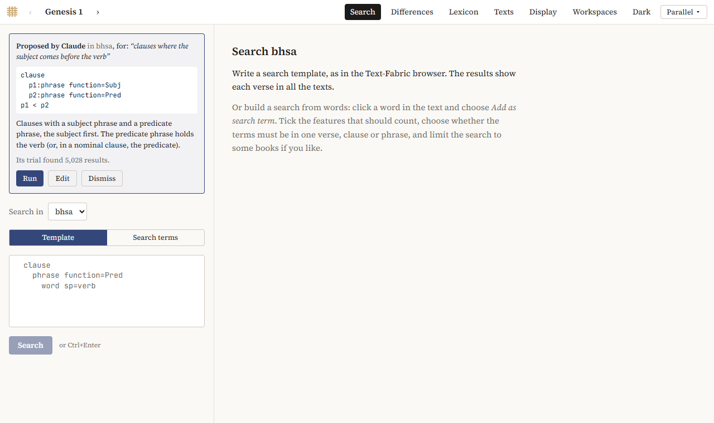

# Asking Claude

You can ask Claude, in your own words, for a search: *find all cases of >LHJM/ in the BHSA*, or *clauses where the object comes before the verb*. Claude writes a search template, tries it, and sends it to the Explorer. You decide whether it runs. This uses your own Claude subscription, in Claude Desktop or Claude Code.

## What Claude does, and what it doesn't

- Claude writes the [search template](searching.md#templates); the Explorer shows it with Claude's explanation, so you can read and change it.
- Before sending it, Claude may check the template and try it on a few results, to see that it finds what you asked for.
- Nothing runs by itself: you click *Run*.
- The results always come from the Explorer's own search, never from Claude's text, so they are the same as for a search you had typed yourself.
- The search keeps where it came from (*Proposed by Claude, … for: …*): in its link, in a saved workspace, and when you cite it.

Claude can be wrong. Check the template, and look at a few results before you trust a count.

## Setting it up

**Always first:** start CACCHT Explorer and keep it running. Claude talks to the running program.

### In Claude Desktop

1. Download `CACCHT-Explorer.mcpb` from the release (under *Assets*, next to the program; see [Getting started](getting-started.md#download)).
2. Install it, in one of these ways:
   - double-click the downloaded file: Claude Desktop opens it and offers to install it; click *Install*;
   - or, in Claude Desktop, go to *Settings → Extensions*, and choose *Install Extension…* (under *Advanced settings*), then the file;
   - or drag the file into the *Settings → Extensions* window.
3. Check that *CACCHT Explorer* is switched on under *Settings → Extensions*.
4. Start a new chat. The tools menu (the button below the message box) now lists *CACCHT Explorer*.

You need a recent Claude Desktop. The extension needs nothing else: no Python and no Node.js of your own. If your Claude Desktop names its menus differently, look under *Extensions* for the button that installs one.

**Without the extension** (if installing it doesn't work): in Claude Desktop, *Settings → Developer → Edit Config* opens `claude_desktop_config.json`. Add the program, with its path on your computer, and restart Claude Desktop:

```json
{
  "mcpServers": {
    "context-fabric": {
      "command": "C:\\path\\to\\cfabric-browser\\cfabric-browser.exe",
      "args": ["mcp"]
    }
  }
}
```

On a Mac the command is `/Applications/CACCHT Explorer.app/Contents/MacOS/cfabric-browser`; on Linux, the path of `cfabric-browser/cfabric-browser`.

### In Claude Code

In a terminal, once:

```
claude mcp add --transport http context-fabric http://127.0.0.1:8107/mcp
```

8107 is the program's usual port. If another program had taken it, the log (`.cfabric/logs/cfabric-browser.log` in your home folder) gives the address with the port the Explorer uses.

## Asking

Ask Claude, for instance:

- *Find all cases of >LHJM/ in the BHSA.*
- *All infinitives construct of HLK[.*
- *Clauses in Genesis where the subject comes before the verb.*

The first time Claude uses a tool, it asks your permission. Claude reads a guide to searching the BHSA, checks its template and tries it, and tells you it has sent a search.

In the Explorer, the search appears above the search form (in Parallel: click *Search* in the top bar), with your request, the template, Claude's explanation and how many results its trial found:



- *Run* runs it, as if you had typed it;
- *Edit* puts it in the editor, to change it first;
- *Dismiss* drops it.

So far Claude knows the BHSA best: its guide to searching covers the BHSA's features, with worked examples. It can search the Samaritan Pentateuch and the scrolls too, but with less help.

## Privacy

What you ask goes to Anthropic, as anything you ask Claude. The texts stay on your computer, apart from the few results Claude sees when it tries a template. The Explorer answers only programs on your own computer, not other web pages or other computers.
