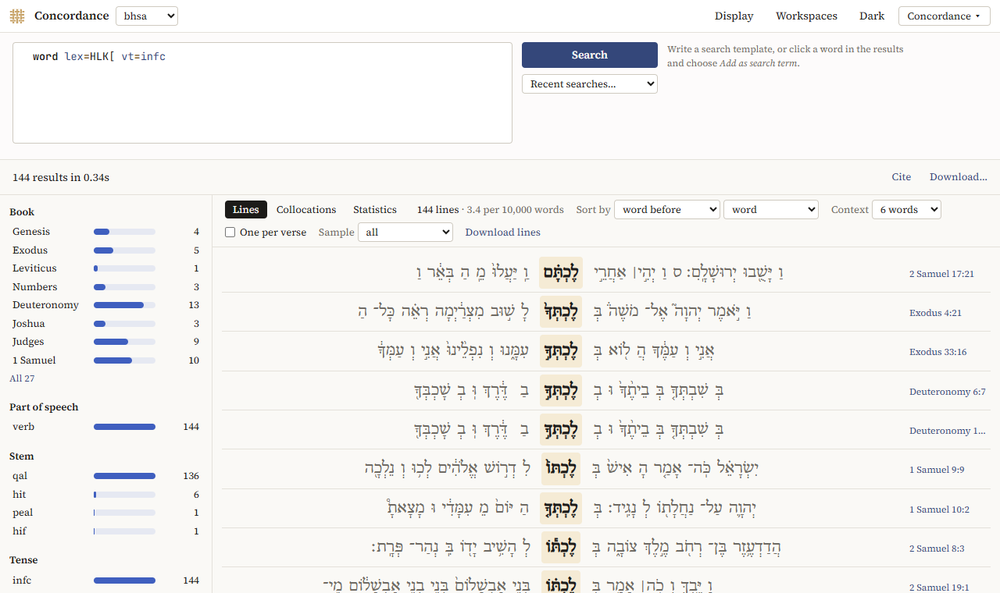
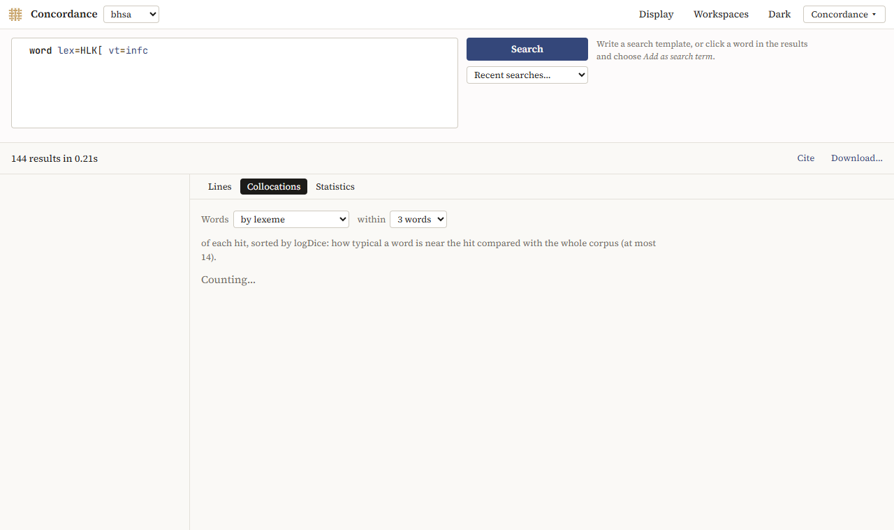

# The Concordance

The Concordance shows the results of a search as lines, with the hit in the middle and the words before and after it on either side, as in a printed concordance. The lines can be sorted, filtered, sampled and counted, and the words that occur near the hit can be listed.

## Searching

Choose the text in the box next to *Concordance* and write a [search template](searching.md#templates), then click *Search*. *Try …* on the first page fills in an example. *Recent searches…* offers your last templates.

To search for words like one in the lines, click it and choose *Add as search term*; tick the features that count, and choose under *Search terms, all in one* whether the terms must be in one verse, clause or phrase. See [Search terms](searching.md#search-terms).

The hit is the word the search found, or, when a result has several, the innermost of them (the words of a phrase, for instance).

## The lines

Above the lines, the number of lines and how often that is per 10,000 words of the text.

- **Sort by**: *result order* (the order of the text), the hit itself, or a word up to three before or after it (*word before*, *2nd word after*, …), by its form, its lexeme or its part of speech. Sorting by the word before groups the constructions the hit is used in.
- **Context**: 3, 6 or 10 words on each side. The context stays within the book.
- **One per verse**: only the first hit in each verse.
- **Sample**: 50, 100, 250 or 500 lines at random, to look at a large result; *another* draws a new sample.
- *Previous* and *Next* page through the lines.

Click a reference to read the verse in the Reader; click a word for the word panel.

For Hebrew, *before* is on the right of the hit, as the text runs.

## Filters

On the left, the hits are counted by book, part of speech, stem, tense, person, gender, number and state (as far as the text has them). Click a value to keep only those lines; click it again to drop the filter. Filters on different features combine (the qal and Genesis); a second value of the same feature takes the place of the first. On a phone, they are under *Filters*.

## Collocations

*Collocations* lists the words that occur near the hit more often than you would expect: *Words* by lexeme, by form (consonants) or by part of speech, *within* 1 to 5 words of each hit. They are sorted by *logDice*, a measure of how typical a word is near the hit compared with the whole text; 14 is the highest.

## Statistics

*Statistics* counts the values of a feature over the results, and the results per book, as for a [search](searching.md#statistics).

## Downloading

*Download lines* saves the lines as a spreadsheet (TSV), in the order and with the filters you chose, at most 20,000 lines.

## Translations

The Concordance also searches a translation, such as the JPS 1917. Its words have the feature `lower`, the word in small letters: `word lower=lord` finds *Lord* and *lord*. Collocations of a translation are by word.
