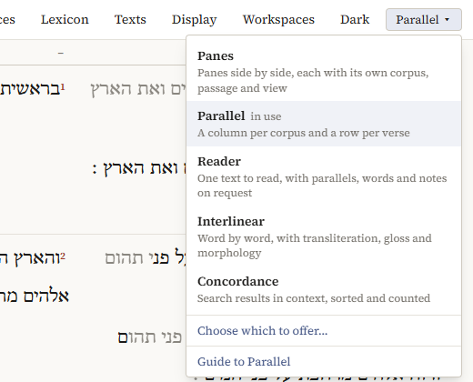
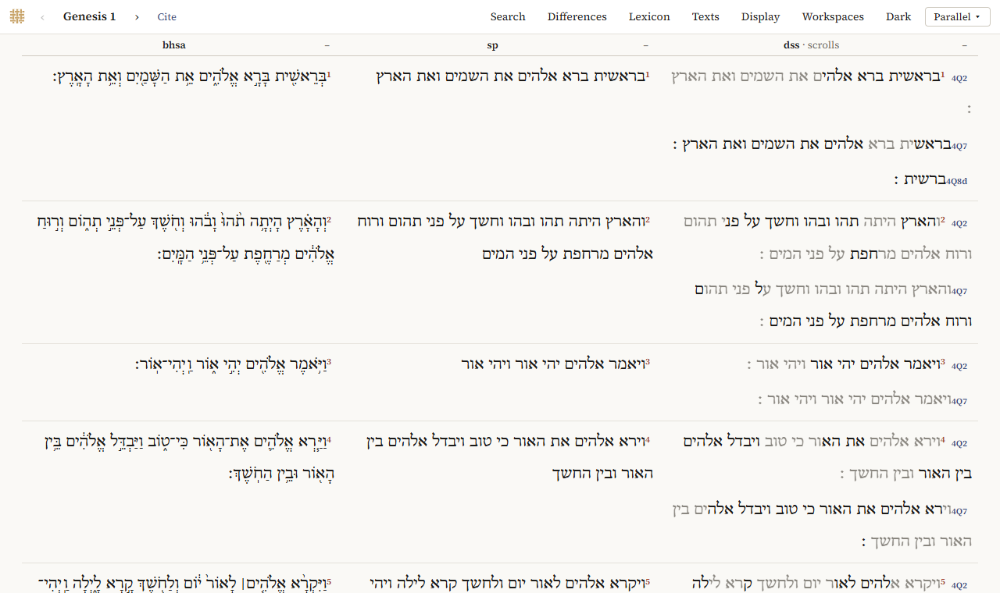
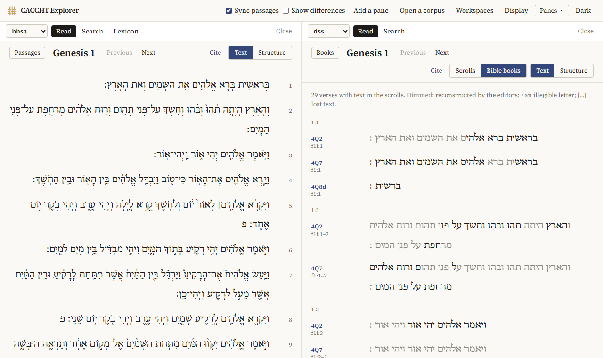
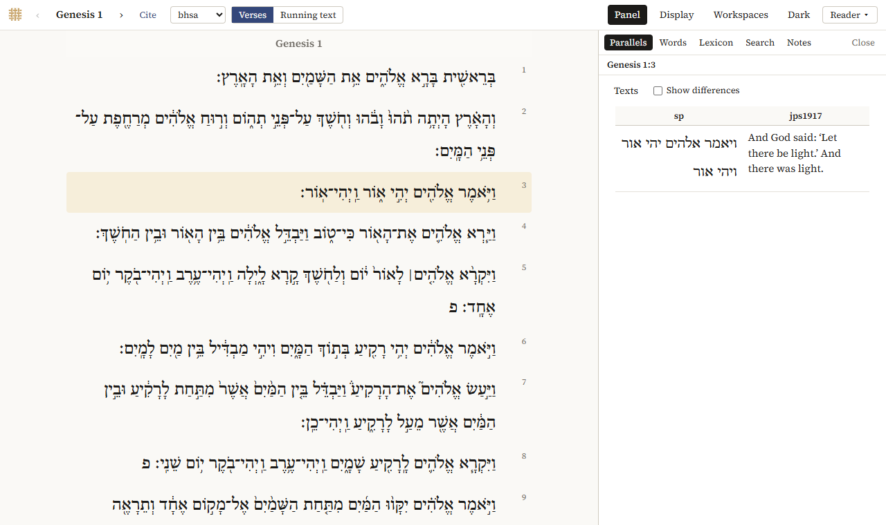
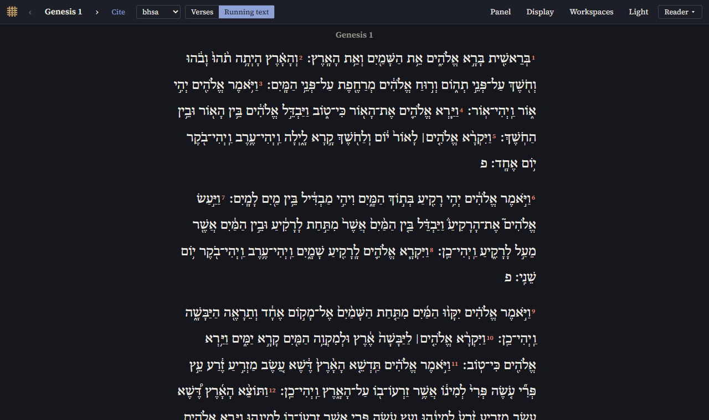
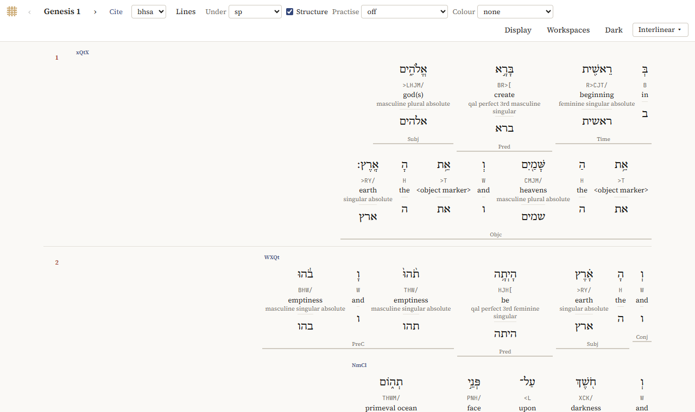

# The five ways of working

The Explorer has five interfaces for the same texts. The menu at the top right, with the name of the one in use (*Parallel ▾*), lists them, with a line on what each is for.

When you switch, the passage, the texts, the search and the lexicon go along, so you see the same thing in another way. The program remembers which interface you used last and opens in it next time.

## Parallel

A column per text and a row per verse: the BHSA, the Samaritan Pentateuch and the Dead Sea Scrolls line up verse by verse. This is where the program opens.

- The chapter is at the top left: click it to choose a book and chapter; `‹` and `›`, or the arrow keys, go to the previous and next chapter.
- *Texts* turns texts on and off and changes their order; `–` above a column removes it.
- In the column of the scrolls, each verse has a line for every scroll that has it, with the scroll's name (such as *4Q2*) next to it.
- *Differences* marks where the texts differ from the first column; see [Differences](reading.md#differences).
- *Search* finds words or constructions, with the results shown in all the texts; see [Searching](searching.md).
- *Lexicon* shows the lexicon of the BHSA in place of the chapter; see [The lexicon](words.md#the-lexicon).
- Clicking a word opens the word panel on the left; see [Words](words.md).

## Panes

Corpora side by side, each in its own pane, with its own passage and view. Use Panes when the texts should not follow each other, for instance to read a scroll as a whole next to the BHSA, or to have a search open next to a text.

- *Add a pane* adds a pane, up to four; *Close* closes one.
- At the top of each pane, choose its corpus and its view: *Read*, *Search*, or *Lexicon* (BHSA).
- The list on the left of a pane (*Passages* when the pane is narrow) chooses the passage; *Previous* and *Next* go through them.
- *Text* shows the text as it runs; *Structure* shows how it is built up of phrases, clauses and sentences, with their features.
- For the Dead Sea Scrolls, *Scrolls* reads a scroll as it is, and *Bible books* reads them by biblical book; see [The scrolls by biblical book](reading.md#the-scrolls-by-biblical-book).
- *Sync passages* makes the other panes follow when you open a passage in one; *Show differences* marks the words where the panes differ from the first.
- *Open a corpus* opens another corpus from your computer.

## Reader

One text in a quiet column, with everything else on request. Chapters follow each other as you scroll.

- Choose the text in the box next to *Cite*.
- *Verses* gives a line per verse; *Running text* lets the verses run on in paragraphs, which end where the BHSA has a *petuhah* (פ) or *setumah* (ס).
- Click a verse to select it. The panel on the right shows, in tabs:
  - *Parallels*: the verse in the other texts (*Texts* chooses them), with *Show differences*;
  - *Words*: its words with gloss and morphology; click one for all about it;
  - *Lexicon*: its lexemes, with *All* for every verse each one occurs in;
  - *Search*: a search for words like one of these, which opens in Parallel;
  - *Notes*: your own note on the verse, and a star to bookmark it; see [Notes, workspaces and citing](notes-and-citing.md).
- *Panel* opens and closes the panel.

The Reader can also be dark, as every interface (*Dark* in the top bar):

## Interlinear

Word by word, with lines under each word: by default the transliteration of the lexeme, the gloss and the morphology.

- *Lines* chooses the lines and their order: *Word*, *Transliteration*, *Lexeme*, *Gloss*, *BDB*, *Part of speech*, *Morphology*, or any feature of the corpus (*Add a feature*).
- *Under* puts another text under it, word by word, with its differences marked; a translation gets a line per verse.
- *Structure* shows the phrases with their function (*Subj*, *Pred*, *Objc*, …) and the clauses with their type.
- *Colour* colours the words by part of speech, or the verbs by stem.
- *Practise* hides a line: click a word's `?` to see it. Useful for learning vocabulary or parsing.
- Click a word for all its features.

## Concordance

Search results as lines with the hit in the middle, sorted, filtered and counted. See [The Concordance](concordance.md).

## Switching and hiding

Choose an interface in the menu at the top right. What you are looking at goes along:

- the texts and their order;
- the chapter and the verse (numbered as in the BHSA, so that a passage in another text is found by its counterpart);
- the search, the lexeme in the lexicon, and whether differences are shown.

What an interface can't show is kept for when you come back to one that can.

**Hiding.** *Choose which to offer…* in the menu lists the interfaces with a tick box each: untick the ones you don't use. The one in use can't be hidden, and Panes and Parallel can't both be hidden.

**Help.** *Guide to …* at the bottom of the menu opens this guide where the interface in use is explained. *← Back to the Explorer* at the top of the guide returns to where you were.
