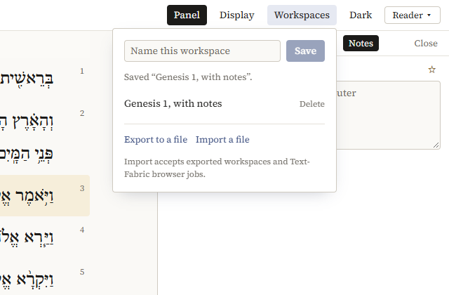

# Notes, workspaces and citing

## Notes

In the Reader, click a verse and open the *Notes* tab of the panel:

- write your note in the box; it is saved when you click elsewhere;
- `☆` bookmarks the verse (`★` when it is bookmarked);
- *All your notes in …* lists your notes in that text, the newest first; click one to go to its verse.

Notes stay on your computer, in the program (or, if you use the Explorer in your web browser, in that browser). They go along when you export a workspace, so that is also how you take them to another computer.

## Workspaces

*Workspaces* in the top bar keeps what you are looking at: the interface, the texts, the passage, the search, the lexicon and the settings in it.



- Type a name under *Name this workspace* and click *Save*. The list below has your saved workspaces: click one to open it again, *Delete* to drop it.
- *Export to a file* saves the current workspace as a file, with your notes. Send it to a colleague, or keep it as a record of a search.
- *Import a file* opens an exported workspace, and adds its notes to yours. It also opens jobs saved by the Text-Fabric browser.

Saved workspaces are kept in the program, so they are not on another computer unless you export them.

## Links

Everything you see is in the address of the page: the interface, the passage, the texts, the search. When you use the Explorer in your web browser, a link copied from the address bar opens the same view on another computer that has the Explorer and the same corpora (at the address `http://127.0.0.1:8107/`, or the port it uses there).

A search's results are kept for a while; a link to an older search runs it again.

## Citing

*Cite*, in the top bar or above a passage or a search, gives a citation to copy (*Copy*). It names the passage or the search, the text with its version and DOI, the version of the Explorer and of Context-Fabric, and the date. For instance:

```
Genesis 1. BHSA = Biblia Hebraica Stuttgartensia Amstelodamensis, version 2021. https://doi.org/10.5281/zenodo.1007624. Read with CACCHT Explorer 0.1.0 (context-fabric 0.6.0rc1), 2026-10-21.
```

For a search, the citation gives the template and the number of results, so that others can repeat it. A search [proposed by Claude](asking-claude.md) adds who proposed it, when, and for what request, and whether you changed the template.

A translation is cited by its edition and where its text came from.

Cite the version of a corpus you used: corpora are updated, and a later version may give other results. The cards on [caccht.github.io](https://caccht.github.io/#corpora) give the DOI of each release.
