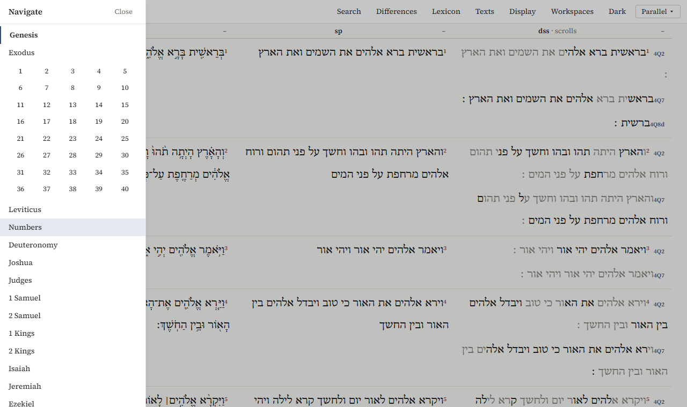
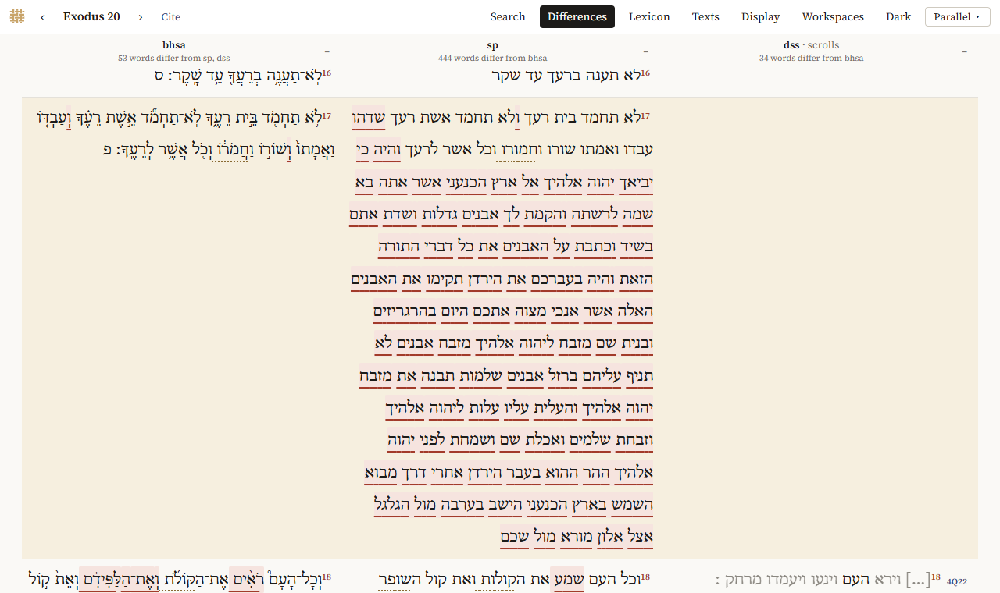

# Reading and comparing

## Going to a passage

In Parallel, the Reader and the Interlinear, the chapter is at the top left (*Genesis 1*). Click it for the list of books; click a book for its chapters, and a number to open that chapter. *Esc*, or a click beside the list, closes it.

`‹` and `›` next to it go to the previous and next chapter, and so do the arrow keys `←` and `→` (not while you are typing in a box).

In Panes, each pane has its own list on the left: books, then chapters. *Previous* and *Next* above the text go through them.

A passage has its own address (the program keeps everything in it), so a link copied from the address bar opens the same passage, in the same interface, with the same texts. *Workspaces* saves what you are looking at; see [Notes, workspaces and citing](notes-and-citing.md).

## Choosing texts

*Texts* in the top bar of Parallel (and in the Reader's *Parallels* tab) lists the open corpora:

- tick a text to show it, untick it to hide it;
- `←` and `→` move it to the left or right;
- *Add a text…* opens the library, to open another corpus, download one, or add the [JPS 1917](datasets.md#the-jps-1917-translation) or [BDB](datasets.md#the-bdb-dictionary); see [Adding texts](adding-texts.md).

The first column is the one the others are compared with.

The rows follow the verses of the BHSA. A text that numbers a verse otherwise is lined up by its counterpart, and a chapter a text doesn't have shows *not in this corpus*.

## Vocalized or unvocalized

*Display → Text* chooses how the BHSA is shown:

- *Vocalized*: with vowels and accents; where the Masoretes read a word otherwise than it is written, the qere;
- *Unvocalized*: the consonants as written, the ketiv.

The Samaritan Pentateuch and the scrolls have one text, without vowels, so the choice applies only to the BHSA.

The *Display* menu also has *Show object types*, *Show each corpus' standard features*, *Hide minor object types* and *Show node numbers*, which change what *Structure* shows in Panes.

## Reading side by side

In Parallel the texts follow each other by themselves: there is one chapter for all columns.

In Panes, *Sync passages* does this: when you open a passage in one pane, the others go to the same passage. Where a text numbers the verse otherwise, the pane says which verse it shows instead; where it has no counterpart, it says so.

## Differences

*Differences* (in Parallel; *Show differences* in Panes and in the Reader's *Parallels* tab) marks the words where the texts differ from the first column. Above each column it says how many words differ.

Two kinds of mark:

- **a variant**: a pale red background with a red line under the word;
- **spelling** (*matres lectionis*): a dotted line under the word, where the only difference is a letter for a vowel, such as plene against defective spelling (לא against לוא).

Hover over a marked word to see what the other text has.

What counts:

- only the consonants: vowels, accents and other marks don't count;
- word division doesn't count: two words written as one are not a difference;
- a word that only one text has is marked in that text;
- in the scrolls, letters reconstructed by the editors never count, and neither does what another text has in their place; lost and illegible letters count only between two letters that are preserved.

**The BHSA, the SP and the scrolls together.** When the first two columns are the BHSA and the Samaritan Pentateuch and the scrolls are shown too, the program also says, for every place where the BHSA and the SP differ, which scrolls side with which. The scrolls' column shows this per verse, with a chip for each scroll: *4Q7 = bhsa*, *4Q7 = sp*, or *4Q7 other*. Scrolls whose text is lost or reconstructed there are left out.

Only Hebrew texts are compared: a translation is left out.

In the Interlinear, the text chosen under *Under* is compared with the main text word by word, and both show the marks.

## The scrolls by biblical book

The Dead Sea Scrolls are manuscripts, not books of the Bible, and most scrolls hold only fragments. The Explorer reads them in two ways:

- **By biblical book** (Parallel, the Reader, and Panes with *Bible books*): per verse, the text of every scroll that has it, one line per scroll. In Panes, the list on the left shows only chapters with text in the scrolls, with how many verses and scrolls each has, and the page begins with how many verses have text in the scrolls. Click a scroll's name to read it at that place.
- **By scroll** (Panes, *Scrolls*): a scroll as it is, by its fragments or columns and lines, including the non-biblical scrolls.

What the signs mean:

- dimmed letters are reconstructed by the editors;
- `◦` is a letter that can't be read;
- `[…]` is lost text;
- *also non-biblical* (or `*` in Parallel) marks a text that the edition also lists among the non-biblical material: its identification is disputed, or the scroll is partly non-biblical.
