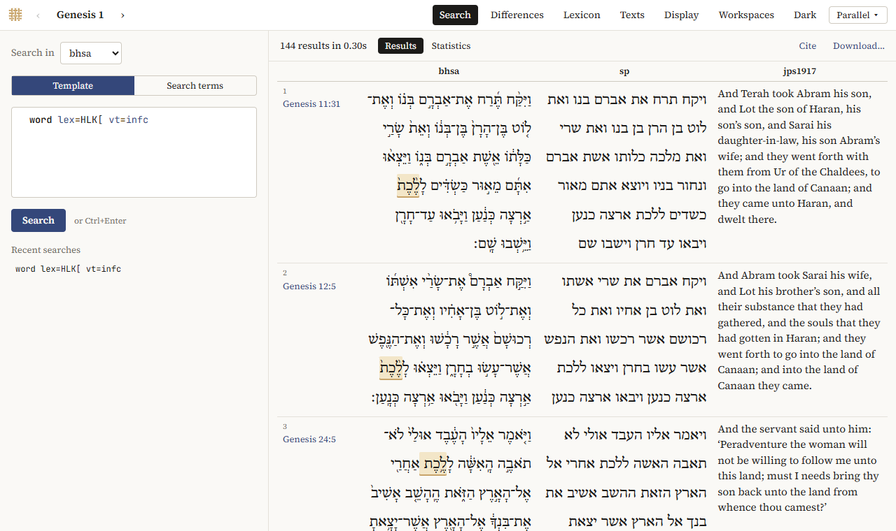
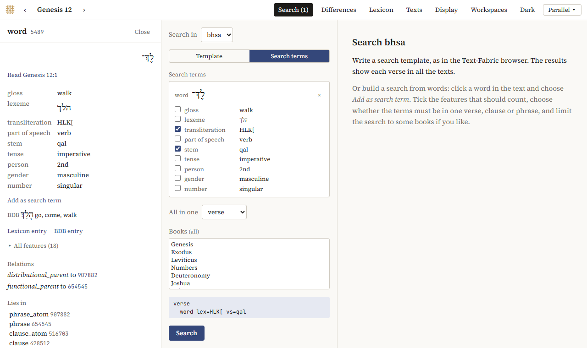
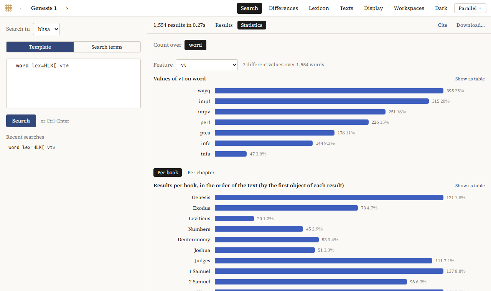

# Searching

The Explorer searches with **search templates**, the search language of Text-Fabric. A template describes what you look for, one object per line: a word with certain features, a phrase with a certain function, a clause that contains both. You can write one yourself, have one made from words you click (*Search terms*), or [ask Claude](asking-claude.md) for one.

In Parallel, *Search* in the top bar opens the search, which shows each result as a verse in all the texts. Panes have a *Search* view, and the [Concordance](concordance.md) shows results as lines with the hit in the middle. A search goes along when you switch between them.



## Templates

*Search* opens on *Template*. Choose the text under *Search in*, write the template, and click *Search* (or press *Ctrl+Enter*).

### One line: words with features

A line is an object type and its features: `word` and then what the word must be.

| You look for | Template | In the BHSA |
|---|---|---|
| all cases of אלהים | `word lex=>LHJM/` | 2,601 |
| the verb הלך in all its forms | `word lex=HLK[` | 1,554 |
| הלך in the qal | `word lex=HLK[ vs=qal` | 1,412 |
| infinitives construct of הלך | `word lex=HLK[ vt=infc` | 144 |
| hiphil imperfects | `word vs=hif vt=impf` | 2,264 |
| nouns in the construct state | `word sp=subs st=c` | 36,679 |
| Aramaic words | `word language=Aramaic` | 6,106 |

The values are the BHSA's codes, not English words:

- **Lexemes** are written in the ETCBC's transliteration: `>` א, `B` ב, `G` ג, `D` ד, `H` ה, `W` ו, `Z` ז, `X` ח, `V` ט, `J` י, `K` כ, `L` ל, `M` מ, `N` נ, `S` ס, `<` ע, `P` פ, `Y` צ, `Q` ק, `R` ר, `F` שׂ, `C` שׁ, `T` ת. A verb ends in `[` (`HLK[`), a noun or adjective in `/` (`MLK/`), a particle in neither (`KJ`), so the ending already separates the verb `DBR[` *speak* from the noun `DBR/` *word*. Homonyms that would otherwise be written the same get one or more `=` before the ending: `BR>[` *create* and `BR>==[` *cut down*, `H` the article and `H=` the interrogative he.

  To find how a lexeme is written, look it up in the [lexicon](words.md#the-lexicon): *Find* takes the Hebrew or an English gloss (*create*), and each lexeme in the list shows its transliteration, `=` included. The hover card and the word panel show it too, as *transliteration*.
- **Part of speech** (`sp`): `subs` noun, `verb`, `adjv` adjective, `nmpr` proper noun, `prep` preposition, `conj` conjunction, `art` article, `nega` negation, …
- **Stem** (`vs`): `qal`, `nif`, `piel`, `pual`, `hit`, `hif`, `hof`, …
- **Tense** (`vt`): `perf`, `impf`, `wayq` wayyiqtol, `impv`, `infc`, `infa`, `ptca` active participle, `ptcp` passive participle.
- **Person, gender, number, state**: `ps=p1|p2|p3`, `gn=m|f`, `nu=sg|pl|du`, `st=a|c`.

You don't have to know them by heart. While you type, the editor offers the object types and features of the corpus, and after `=` the values a feature has, with how often each occurs. Hover over a feature for what it means.

`|` allows several values (`ps=p1|p2`), `#` excludes one (`prs#absent`: with a suffix), and `~` matches a pattern (`nametype~topo`).

### Indented lines: inside

An indented line lies inside the object above it. That is how you narrow a search to a book or chapter, or ask for words inside a phrase or clause.

**Wayyiqtol forms in Genesis** (2,106 in the BHSA):

```
book book=Genesis
  word vt=wayq
```

**אלהים in Genesis 1** (32 in the BHSA):

```
book book=Genesis
  chapter chapter=1
    word lex=>LHJM/
```

**Clauses with היה as predicate** (3,521 in the BHSA):

```
clause
  phrase function=Pred
    word lex=HJH[
```

**Clauses where אלהים is the subject of אמר** (147 in the BHSA):

```
clause
  phrase function=Pred
    word lex=>MR[
  phrase function=Subj
    word lex=>LHJM/
```


Book names in templates are the BHSA's, in Latin: `Genesis`, `Exodus`, `Leviticus`, `Numeri`, `Deuteronomium`, …, `Psalmi`, `Reges_I` (1 Kings). In Parallel, *Books* under *Search terms* chooses books without that.

Phrases have a `function` (`Pred` predicate, `Subj` subject, `Objc` object, `Cmpl` complement, `Adju` adjunct, `Time`, `Loca`, …) and a type (`typ`: `VP`, `NP`, `PP`, …); clauses have a type (`typ`: `Way0`, `xQtX`, `NmCl`, …), a relation (`rela`: `Objc`, `Attr`, …) and a `domain` (`N` narrative, `Q` direct speech). The word panel shows all features of a word, phrase or clause: click a word, then *Lies in*.

### Order: before and after

Objects at the same level come in any order. To fix their order, give them names and relate them on a line of their own: `<` means *before*, `<:` *right before*.

**Clauses with the subject before the predicate** (5,028 in the BHSA):

```
clause
  p1:phrase function=Subj
  p2:phrase function=Pred
p1 < p2
```

**An infinitive construct right after ל** (4,572 in the BHSA):

```
phrase
  w1:word lex=L
  w2:word vt=infc
w1 <: w2
```

**A noun followed right away by an adjective** (1,579 in the BHSA):

```
phrase typ=NP
  w1:word sp=subs
  w2:word sp=adjv
w1 <: w2
```


### Without, and for all

`/without/` … `/-/` finds objects without something inside; `/where/` … `/have/` … `/-/` finds objects all of whose parts of one kind have something.

**Verses without a verb** (1,607 in the BHSA):

```
verse
/without/
  word sp=verb
/-/
```

**Subjects that are only proper names** (5,893 in the BHSA): every word of the subject is a proper name. Give the word a name, here `w`, and say under `/have/` what is true of it:

```
phrase function=Subj
/where/
  w:word
/have/
  w sp=nmpr
/-/
```

Without the name, `word sp=nmpr` under `/have/` would be another word, and the template would find subjects with at least one proper name (10,484). The same as above, shorter: subjects *without* a word that is not a proper name (`#` means "not"):

```
phrase function=Subj
/without/
  word sp#nmpr
/-/
```


### What is counted

A result is a combination of objects, one for each line of the template. So `verse` with two words under it gives a result for every pair of such words in a verse, not one per verse: *verses with both אלהים and ברא* gives 21 results, in 12 verses. Put what you want to count at the top, or alone.

### When a template is wrong

The editor checks the template as you type and marks a line it can't use in red, and a red box under the editor says why (*Unknown feature "…"*, for instance). Templates that find nothing usually have a value in English (`sp=noun` instead of `subs`), a lexeme without its ending (`HLK` instead of `HLK[`), or an English book name (`Psalms` instead of `Psalmi`).

## Search terms

To search without writing a template, start from words in the text:

1. Click a word, and in the word panel *Add as search term*. The search opens with the word as a term.
2. Tick the features that should count, such as its lexeme and stem but not its person.
3. Add more terms in the same way, if you like.
4. *All in one* chooses whether the terms must be in one verse, clause or phrase; *Books* limits the search to some books.
5. Click *Search*.



The template the terms make is shown under them. Switching to *Template* puts it in the editor, to change it further. Terms are kept while the program is open, not in links or workspaces.

In the Reader, the *Search* tab of the panel and *Add as search term* open the search in Parallel.

## Results

While a search runs, the line above the results counts them (*Searching… 812 results so far*); *Stop* stops it. When it is done, it says how many results it found and in how long.

- **In Parallel**, each result is a verse in all the texts shown, with the hit marked in the searched text, 25 to a page (*Previous*, *Next*). Click the reference to read the passage.
- **In Panes**, the results are a list; `▸` before a result shows its structure, with the template's features.

*Recent searches* lists your last templates per corpus (in every interface); click one to use it again.

### Statistics

*Statistics*, next to *Results*, counts the results:

- **values of a feature**: *Count over* chooses the part of the result (the clause, the word, …), *Feature* the feature; the 25 most frequent values are shown, then the rest together;
- **results per book** (or per chapter), in the order of the text; click a bar to read that book or chapter.

Each chart has *Show as table*. Write a feature with `*` and no value in the template (`word lex=HLK[ vs*`) to count it without limiting the search: it is offered first.



### Downloading

*Download…* saves the results as a spreadsheet: one row per result, with its passage and, for each line of the template, its text and its features. The features in the template are always included; tick more in the list. *TSV for Excel* is a file that Excel opens with the Hebrew intact; *TSV* is for other programs.

*Cite* gives a citation of the search: the corpus and its version, the template, the number of results, and the versions of the Explorer and Context-Fabric.

## Limits

- A search stops after 60 seconds: *Stopped after 60s with … results. Narrow the template*. Most searches take less than a second.
- A search stops at 500,000 results (*First … results (stopped at the limit)*).
- Two searches run at a time; another waits (*Waiting for a free search worker…*).
- The program keeps the last 100 searches. An older link runs its search again.

With `cfabric-browser` on the command line, `--timeout`, `--max-results` and `--workers` change these limits.
