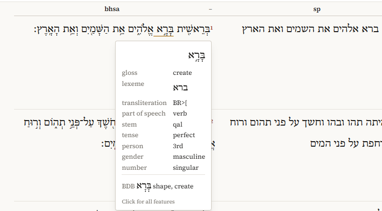
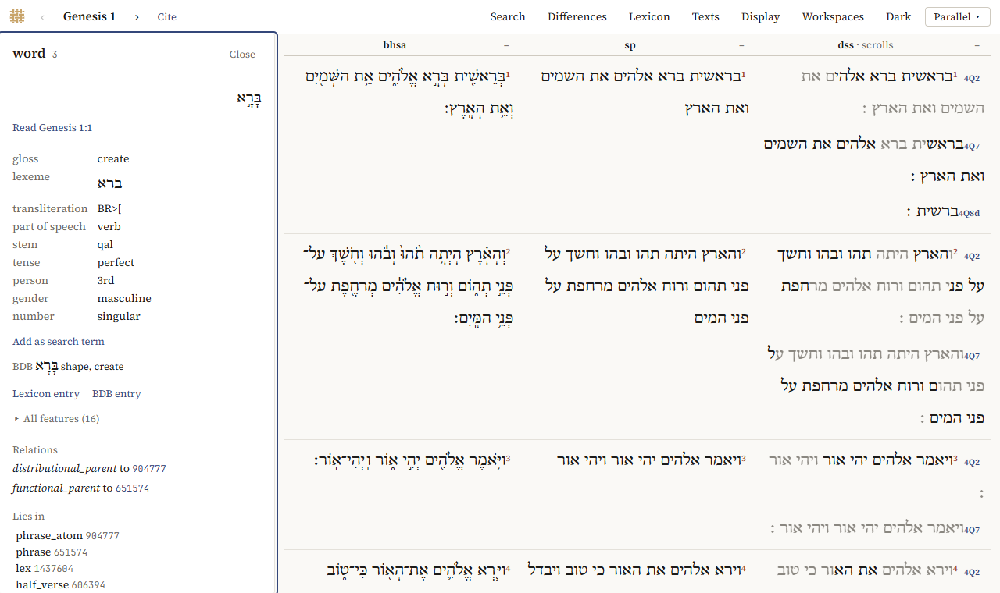
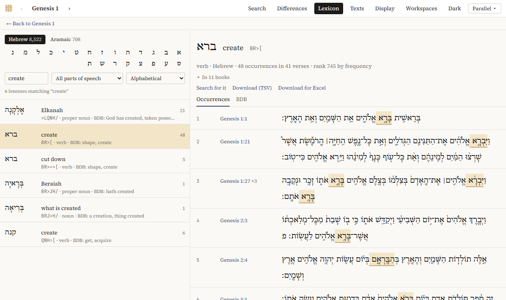
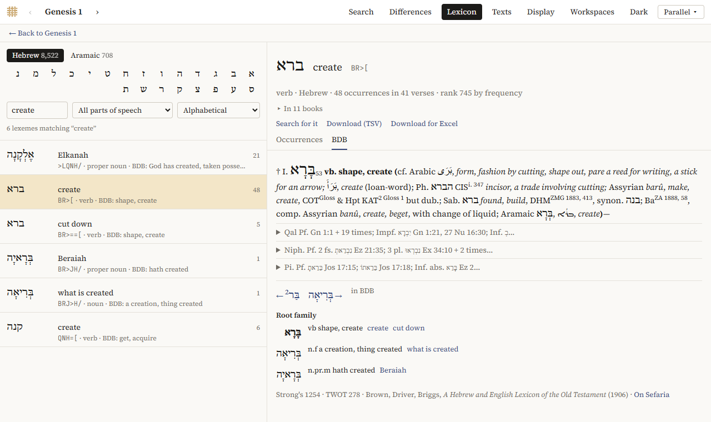

# Words

Every word in the BHSA, the Samaritan Pentateuch and the Dead Sea Scrolls carries its lexeme, part of speech and morphology. The Explorer shows them in three places: a card when you hover over a word, the word panel when you click it, and the lexicon.

## Hovering over a word

Hold the mouse still over a word for a moment, and a card shows what matters most about it:

- the gloss, the lexeme and its transliteration;
- the part of speech, and for verbs the stem and tense;
- person, gender, number and state, where they apply; the suffix, if the word has one;
- the language, when it isn't Hebrew (Aramaic);
- the BDB entry, with its short definition, once [BDB](#bdb) has been added;
- with *Differences* on, what the other texts have here.

Words in the Dead Sea Scrolls get their gloss and BDB entry from the BHSA, through their lexeme; the card says so (*· bhsa*).

The card disappears when you scroll. A translation has no card.

## The word panel

Click a word for the word panel: in Parallel on the left, in Panes, the Interlinear and the Concordance on the right, and in the Reader in the *Words* tab.

From the top:

- the word, and *Read …*, to read its passage;
- the same summary as on the card;
- *Add as search term*: a search for words like this one, where you choose which of its features count; see [Searching](searching.md) (in Parallel, the Reader and the Concordance);
- *Lexicon entry*, and *BDB entry* once BDB has been added: the lexeme's page in the lexicon (BHSA; in the Reader and the Interlinear this switches to Parallel);
- *All features*, folded: every feature of the word with its value. *Also the g_ features* adds the text in other spellings;
- *Relations*, *Lies in* and *Contains*: how the word fits in the corpus' structure (its phrase, clause, verse …). Click one to inspect it.

*Close*, or *Esc*, closes the panel.

## The lexicon

The lexicon of the BHSA lists all its lexemes, Hebrew and Aramaic, with every verse each one occurs in. Open it with *Lexicon* in the top bar of Parallel, the *Lexicon* view of a pane in Panes, or *Lexicon entry* in the word panel. In Parallel, *← Back to …* returns to the chapter.

**Finding a lexeme.** On the left:

- *Hebrew* and *Aramaic* choose the language, and the letters choose the first letter;
- *Find* searches all letters at once: by Hebrew (with or without vowels), by transliteration (`BR>[`), by gloss (*create*) or, with BDB added, by BDB's definition;
- *All parts of speech* narrows the list to nouns, verbs, proper nouns, …;
- the order is *Alphabetical*, *Most frequent first*, or, with BDB added, *By root (BDB)*, which lists each lexeme under its root as BDB does.

Each line gives the lexeme, its gloss, its transliteration and part of speech, BDB's short definition, and how often it occurs.

**A lexeme's page.** On the right:

- its part of speech, language, how often it occurs, in how many verses, and its rank by frequency;
- *In … books*: unfold it for how the occurrences are spread over the books; click a book to see only its verses, *All books* for all again;
- *Occurrences*: every verse, with the word marked; click the reference to read the verse in all the texts;
- *Search for it*: a search for the lexeme, to refine it or see its statistics;
- *Download (TSV)* and *Download for Excel*: the occurrences as a spreadsheet (of the chosen book only, if you chose one).

## BDB

*A Hebrew and English Lexicon of the Old Testament* by Brown, Driver and Briggs (1906) can be added from the library: *Texts → Add a text…*, under *Dictionaries*, *Add*. See [The BDB dictionary](datasets.md#the-bdb-dictionary).

A lexeme's page then has a tab *BDB* with its entry:

- verse references open the verse; references to other entries show that entry;
- BDB's abbreviations are explained when you hover over them;
- in long entries, each stem (*Qal*, *Niph.*, *Pi.*, …) is folded: click it to unfold;
- *Root family* lists the other words of the root, with links to their lexemes;
- `←` and `→` go to the previous and next entry in BDB;
- *On Sefaria* opens the entry on Sefaria's site.

Some lexemes are linked to more than one entry: *Linked to* lists them. Where Sefaria's text of an entry is incomplete, the page says so and gives the short definition.

BDB also appears on the hover card, in the word panel, and as the line *BDB* in the Interlinear.
